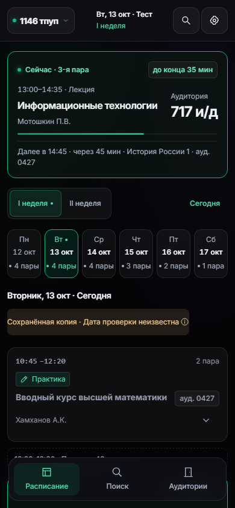
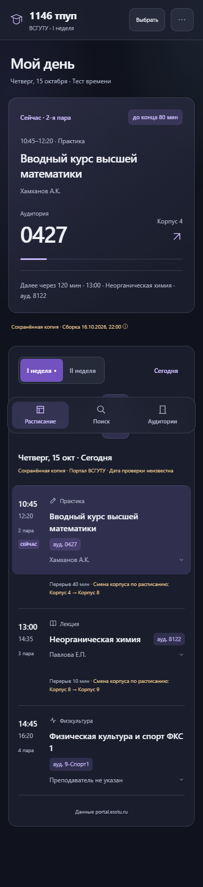
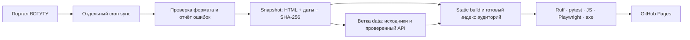

# ВСГУТУ Расписание Live

[Открыть сайт](https://stasdondukov2-sys.github.io/esstu-schedule/) · [Сообщить об ошибке](https://github.com/stasdondukov2-sys/esstu-schedule/issues/new/choose) · [MIT](LICENSE)

Неофициальное PWA для расписаний групп и преподавателей ВСГУТУ. Источник — [portal.esstu.ru](https://portal.esstu.ru/raspisan.htm). Главный экран показывает день, текущую/следующую пару, аудитории и сведения о свежести. Доступны поиск, избранное, личные заметки, подгруппы, сессия, экспорт `.ics`, светлая/тёмная тема и офлайн-копия.

Последняя успешно выбранная группа сохраняется на устройстве. Прямая ссылка имеет вид `?group=1146%20тпуп&section=bakalavriat`; она имеет приоритет над сохранённым выбором. Неизвестная группа показывает ошибку, а не чужое расписание.

## Скриншоты

Stealth Cyber Glass («Обсидиан и неон»): AMOLED-фон, тёмные стеклянные карточки, изумрудный контур текущей пары и фиолетовый — следующей. Компактная шапка содержит группу, дату, поиск и настройки. Состояния карточек и таймеры обновляются по времени; прошедшие пары сохраняют доступ к заметкам. Inter хранится локально и работает офлайн. Светлая тема и уменьшение движения сохранены.

Снимки новой рабочей версии на сохранённых источниках, симулятор времени: 13 октября 2026, 14:00 (на экране «Тест»):



[День на компьютере](docs/screenshots/stealth/day-desktop.png) · [Весь мобильный экран](docs/screenshots/stealth/day-mobile-full.png) · [Светлая тема](docs/screenshots/stealth/day-mobile-light.png)

Предыдущий дизайн:

Настоящие снимки Chromium версии 2.5.0 на сохранённых источниках. Включён встроенный симулятор времени (15 октября 2026, 11:00), что явно отмечено на экране:



[День на компьютере](docs/screenshots/2.5.0/day-desktop.png) · [Неделя](docs/screenshots/2.5.0/week-desktop.png) · [Поиск](docs/screenshots/2.5.0/search-mobile.png) · [Аудитории](docs/screenshots/2.5.0/rooms-mobile.png) · [Светлая тема](docs/screenshots/2.5.0/day-mobile-light.png)

[Изменения и проверка версии 2.5.0](docs/release-2.5.0.md). «Недавние» хранятся на устройстве, поиск находится над фильтрами. Пустой день предлагает ближайший день с известными занятиями; свайп по ленте переключает день. Обновление PWA предлагается над нижней навигацией.

## Поток данных



Push и PR проверяют код на закреплённых исходниках без запросов к порталу.
Публикация из main восстанавливает проверенные исходники и API из ветки `data`.
При первом запуске, пока ветки нет, API целиком считывается с опубликованного
Pages; смена публикации во время чтения вызывает ошибку и повторный запуск.
Первый снимок исходников также восстанавливается из артефакта с проверкой всех
SHA-256 опубликованного API. Обновление интерфейса сохраняет прежний API, если
`parser_revision` не изменился; при изменении парсера API перестраивается из
этих сохранённых HTML без обращения к порталу. Если кандидат данных не проходит порог, выпуск оболочки продолжается с прежним API и причиной parser_rebuild_error. Даты проверки не обновляются.
Дата установки кода записывается отдельно в `code_deployed_at`.

Ошибки источника (`source_issue_count`) отделены от ошибок обработки
(`pipeline_failed_count`). Плейсхолдер каталога заменяется уникальным именем
со страницы с сохранением id. Страница другой группы не используется.
Порог обработки — 5% и максимум +1 п.п. к предыдущему набору. Источник с
известным дефектом запрашивается не чаще раза в сутки. Синхронизация имеет
общий мягкий предел 6 минут; оставшиеся страницы записываются в `deferred`.
Прогресс сохраняется в артефакте, опубликованные API/источники — в ветке `data`
только после успешного деплоя и сверки `build_id`.

## CI/CD

Браузерные и JS-проверки выполняются на сохранённых в Git исходниках до
восстановления постоянного снимка и синхронизации портала. Для живой публикации
после синхронизации выполняются `check_sync --allow-partial`, проверка качества данных и `scripts.smoke_site` без требований
к конкретным фамилиям или порядку групп. Идентификатор оболочки — хеш ресурсов и нормализованного исходника worker,
совпадающий в worker, HTML meta `app-version` и `status.json.build_id`;
`app-release` сохраняет номер выпуска.

Отдельный `freshness.yml` проверяет возраст опубликованной сборки и источников
каждый час и после workflow: порог 12 часов, а также проверка не менее 90% групп
за последние 24 часа по индивидуальным датам; один Issue на проблему и закрытие
при восстановлении. В рабочее окно 08:00–18:00 по Иркутску с понедельника по
субботу синхронизация дополнительно выполняется каждые 30 минут. Подробности и
границы подтверждения — в [повторной проверке](docs/verification-review-current.md).

- `.github/workflows/ci.yml`: push в main и PR — `ruff check`, проверка форматирования, `pytest`, локальный CSS, static build, JS и Playwright/axe. Дополнительный контрактный прогон проверяет новую оболочку со старым опубликованным API. Ручной запуск с `rehearsal=true` читает реальные снимки, выполняет подготовку публикации и не пишет в ветку data и Pages. Право записи в содержимое есть только у отдельного `persist-data` после деплоя. Ветки и PR не публикуются.
- Образ CI закреплён на `ubuntu-24.04`; Actions закреплены на SHA, обновления отслеживает Dependabot. Node.js приложения — 22. Выпуск приложения — 2.5.0, имя кэша оболочки определяется хешем ресурсов. Данные хранятся отдельно в `data-v2`, до 200 ответов; прежние копии переносятся с сохранением предупреждений.
- `.github/workflows/sync.yml`: отдельный запуск каждые три часа (UTC) и вручную через Actions. Планировщик GitHub может задерживать запуск. Cron скачивает кафедры и группы, проверяет отчёты и вызывает тот же проверенный процесс публикации.
- При ошибке или отмене синхронизации/проверок бот открывает один Issue, при повторении обновляет его, после восстановления закрывает. Telegram-токен не требуется. Доставка личного уведомления зависит от ваших настроек GitHub.
- Внешний монитор требует отдельной регистрации и секрета `HEALTHCHECK_URL`. Пинг отправляется только после проверенного деплоя синхронизации. Для Healthchecks: период 3 часа, допустимая задержка 1 час. Без секрета CI явно сообщает, что внешний монитор не настроен. Создан Cronitor heartbeat с тем же периодом и запасом, HEALTHCHECK_URL сохранён. Он ждёт первый пинг после проверенного деплоя main; доставка аварийного оповещения ещё не проверена.
- Неполная загрузка не считается успешной: прежний сайт и последние рабочие файлы сохраняются. Диагностические JSON и браузерные трассы прикладываются к запуску. Артефакт диагностики хранится 14 дней, а проверенные API и исходники — в отдельной ветке `data` без срока удаления.
- `api/status.json`: дата сборки, ревизия кода, агрегированный SHA-256 источников, диапазон дат проверки, число источников без даты, ошибки структуры, неполные расписания и неразобранные ячейки. `api/sources.json` содержит дату и SHA-256 каждого исходного файла.

## Локальный запуск

Python 3.11+ и Node.js 22. Готовый CSS входит в репозиторий.

Порог применяется только к **обновлению данных**: абсолютный предел 25% и не
более одного процентного пункта ухудшения относительно прошлого набора,
перепроверенного по тем же правилам идентификации. Настройки:
`ESSTU_MAX_PARSE_ERROR_RATE` и `ESSTU_MAX_PARSE_REGRESSION`. В режиме обновления
данных группа с ошибкой получает последний корректный JSON того же названия,
проверенный не более семи дней назад, с `is_stale_fallback`, исходной датой и
причиной. Истёкшие/неизвестные даты не продлеваются. Проблемные группы остаются
явно неполными; здоровые могут обновляться независимо. Релиз кода использует
прошлый API и не блокируется этим порогом. Пустой результат всей синхронизации
всегда останавливает обновление данных.

Загрузка использует ETag/Last-Modified, проверку размера и SHA-256, четыре
параллельных запроса и до двух повторов с задержкой. Успешно проверенные файлы
моложе 25 минут переиспользуются при возобновлении; ранее упавшие проверяются
снова. Имя группы проверяется до замены файла по тому же правилу, что и в сборке.
Сбой живого каталога не запускает обход сохранённого списка этого раздела.
Манифест сохраняется по мере загрузки, а checkpoint после этапа синхронизации
сохраняет проверенные исходники в data, не заменяя предыдущий API.

Кэш данных: до 200 ответов, FIFO среди незащищённых; текущая и избранные группы
(до 30 выборов / 64 конечных адресов) защищаются от вытеснения. При наличии копии
через 3,5 секунды она показывается с меткой «Обновляется», а загрузка продолжается
в фоне. Изменённый ответ сохраняется и обновляет открытый экран. При первом
запросе без копии таймаут составляет 12 секунд. Список офлайн-ресурсов создаётся
из всех файлов оболочки, включая локальные аватары.

`week_now` в JSON — снимок на `week_calculated_at`; интерфейс вычисляет текущую
неделю по времени кампуса в браузере. Проверка новой оболочки выполняется раз в
15 минут только в видимой вкладке и при возвращении к ней. После подтверждения
обновления все ранее контролируемые вкладки перезагружаются, первая установка
worker перезагрузку не вызывает.

```sh
pip install --require-hashes -r requirements-dev.txt
npm ci --ignore-scripts
npm run build:css
python -m scripts.build_static_site
python app.py
```

Откройте `http://localhost:8000`. Для статической проверки можно раздавать `dist/` обычным HTTP-сервером. Индекс аудиторий создаётся сборщиком до запуска; HTTP-сервер его не перестраивает.

```sh
ruff check .
ruff format --check .
pytest
npm run test:unit
npx playwright install chromium
npm run test:e2e
```

В Windows с неверным пользовательским `ComSpec` задайте штатный `cmd.exe` только для текущего процесса. CSS можно собрать напрямую: `node node_modules/@tailwindcss/cli/dist/index.mjs -i styles/input.css -o static/app.css --minify`.

## Структура

```text
esstu_schedule/           парсер, HTTP-сервер, каталоги и кэш
  data/                  модели, repository, диагностика, хеши, JSON-хранилище
scripts/                 синхронизация, проверка отчётов и static build
tests/fixtures/          зафиксированные HTML/JSON, контрольные SHA-256
e2e/                     desktop/mobile Playwright и проверки axe
  unit/                  быстрые проверки JS и Service Worker
static/, styles/         интерфейс, SVG, локальный CSS, PWA
requirements*.in/.txt    зависимости Python с версиями и хешами
package-lock.json        зафиксированные зависимости Node
.github/workflows/       CI/Pages и отдельный cron
.github/ISSUE_TEMPLATE/  формы ошибок и предложений
docs/                    аудит, ограничения, скриншоты
app.py, parser.py, …     совместимые прежние точки входа
```

## API

Pages отдаёт готовые JSON. Альтернативный `app.py` предоставляет GET API; на GitHub Pages Python не запускается.

| Данные | Статический адрес (от корня проекта) | Динамический GET |
|---|---|---|
| Статус | `api/status.json` | `/api/status` |
| Группы | `api/groups/bakalavriat.json` | `/api/groups?section=bakalavriat` |
| Группа | `api/schedule/bakalavriat/1.json` | `/api/schedule/bakalavriat/1?group_name=1146%20тпуп` |
| Кафедры | `api/departments/bakalavriat.json` | `/api/departments?section=bakalavriat` |
| Преподаватели | `api/teachers/all/bakalavriat.json` | `/api/teachers/all?section=bakalavriat` |
| Кафедра | `api/department/bakalavriat/Caf5.json` | `/api/department/bakalavriat/Caf5?merge=true` |
| Аудитории | `api/rooms.json` | `/api/rooms` |
| Хеши исходных файлов | `api/sources.json` | — |

Разделы: `bakalavriat`, `spezialitet`, `zo1`, `zo2`; каталоги кафедр доступны для первых двух. Проверяйте `is_incomplete`, `parse_errors`, `source_mode`, `source_checked_at`, `source_sha256`, `is_stale_fallback`. Статические счётчики относятся к конкретной сборке, динамические — к текущему процессу.

Публичная запись профилей отключена: POST возвращает 405, некорректная длина — 400. Локальные фото настраиваются владельцем в `teachers_meta.json`, внешние URL для фото не принимаются. Инициалы создаются без внешних сервисов. См. [P0](docs/P0.md).

## Ограничения

- Проект зависит от доступности и HTML-формата портала. Ошибки, неоднозначные ячейки и несовпадение имени группы отмечаются явно; возможны неточности. Перед важным занятием сверьтесь с официальным источником.
- «Нет пар» относится к известному расписанию. Это не подтверждение свободного доступа в аудиторию или фактического местонахождения преподавателя.
- Даты без года не получают придуманный год и не экспортируются в календарь. Условная схема корпусов не является навигационной картой.
- Сохранённая или офлайн-копия может устареть. Если дата проверки неизвестна, сайт сообщает об этом. Сборка не означает проверку источника в это время.
- Установка PWA, контекстные ярлыки и поведение кеша зависят от браузера и ОС. Старый ярлык с адресом корня домена нужно создать заново по правильной ссылке.
- Избранное, заметки, последняя группа и записи сессии хранятся в браузере и не синхронизируются между устройствами.
- Преподаватели сопоставляются по фамилии и инициалам из портала. Если у разных людей они полностью совпадают, источник не позволяет надёжно разделить их без дополнительного идентификатора.
- При совпадении такого ключа в разных официальных кафедрах профиль получает предупреждение о возможном смешении. Это сигнал для сверки, а не доказательство разных людей; внутри одной кафедры совпадение по одному ключу автоматически не выявляется.
- Автоматические проверки доступности дополнены клавиатурными сценариями, но не заменяют тестирование реальным скринридером на телефоне.
- Динамическому хостингу нужна собственная фоновая синхронизация и постоянное хранилище. Кэш и блокировки работают внутри одного процесса. Результаты нагрузочного тестирования не заявляются.

[Архитектура данных](docs/DATA.md) · [Как участвовать](CONTRIBUTING.md) · [Аудит](docs/AUDIT.md)

MIT распространяется на код проекта; данные портала и сторонние материалы сохраняют права своих владельцев.
