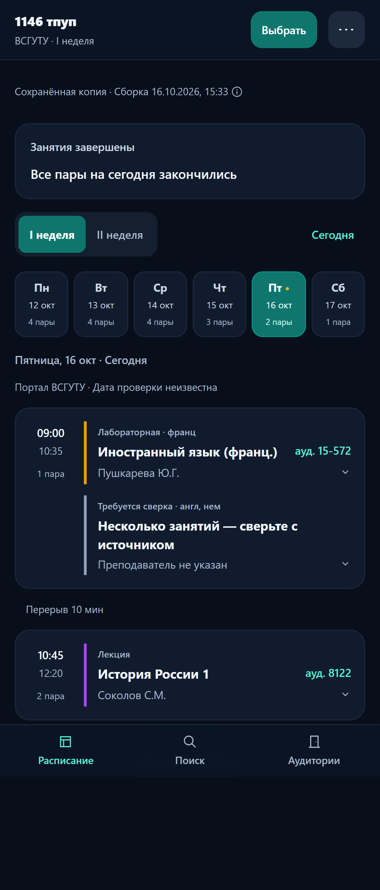
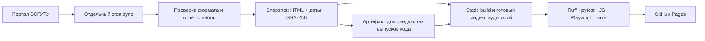

# ВСГУТУ Расписание Live

[Открыть сайт](https://stasdondukov2-sys.github.io/esstu-schedule/) · [Сообщить об ошибке](https://github.com/stasdondukov2-sys/esstu-schedule/issues/new/choose) · [MIT](LICENSE)

Неофициальное PWA для расписаний групп и преподавателей ВСГУТУ. Источник — [portal.esstu.ru](https://portal.esstu.ru/raspisan.htm). Главный экран показывает день, текущую/следующую пару, аудитории и сведения о свежести. Доступны поиск, избранное, личные заметки, подгруппы, сессия, экспорт `.ics`, светлая/тёмная тема и офлайн-копия.

Последняя успешно выбранная группа сохраняется на устройстве. Прямая ссылка имеет вид `?group=1146%20тпуп&section=bakalavriat`; она имеет приоритет над сохранённым выбором. Неизвестная группа показывает ошибку, а не чужое расписание.

## Скриншоты

Настоящие снимки из Chromium, созданные браузерными тестами на сохранённых источниках:



[Настольный экран](docs/screenshots/schedule-desktop.png)

## Поток данных



Обычные push и pull request проверяют код и сборку без запросов к порталу. Публикация кода использует последний успешно проверенный артефакт синхронизации, если он есть; при его отсутствии — снимки репозитория с исходными датами проверки. Дата сборки не подменяет дату проверки источника.

## CI/CD

- `.github/workflows/ci.yml`: каждый push и PR — `ruff check`, проверка форматирования, `pytest`, локальный CSS, static build, JS и Playwright/axe. Из main сайт публикуется только после успешных проверок. Ветки и PR не публикуются.
- `.github/workflows/sync.yml`: отдельный запуск каждые три часа (UTC) и вручную через Actions. Планировщик GitHub может задерживать запуск. Cron скачивает кафедры и группы, проверяет отчёты и вызывает тот же проверенный процесс публикации.
- При падении синхронизации/проверок бот открывает один Issue, при повторении обновляет его, после восстановления закрывает. Telegram-токен не требуется. Доставка личного уведомления зависит от ваших настроек GitHub.
- Неполная загрузка не считается успешной: прежний сайт и последние рабочие файлы сохраняются. Диагностические JSON и браузерные трассы прикладываются к запуску. Успешный snapshot хранится как артефакт 14 дней.
- `api/status.json`: дата сборки, ревизия кода, агрегированный SHA-256 источников, диапазон дат проверки, число источников без даты, ошибки структуры, неполные расписания и неразобранные ячейки. `api/sources.json` содержит дату и SHA-256 каждого исходного файла.

## Локальный запуск

Python 3.11+ и Node.js 22. Готовый CSS входит в репозиторий.

```sh
pip install --require-hashes -r requirements-dev.txt
npm ci --ignore-scripts
npm run build:css
python -m scripts.build_static_site
python app.py
```

Откройте `http://localhost:8000`. Для статической проверки можно раздавать `dist/` обычным HTTP-сервером. Индекс аудиторий создаётся сборщиком до запуска; HTTP-сервер его не перестраивает.

```sh
ruff check .
ruff format --check .
pytest
npm run test:unit
npx playwright install chromium
npm run test:e2e
```

В Windows с неверным пользовательским `ComSpec` задайте штатный `cmd.exe` только для текущего процесса. CSS можно собрать напрямую: `node node_modules/@tailwindcss/cli/dist/index.mjs -i styles/input.css -o static/app.css --minify`.

## Структура

```text
esstu_schedule/           парсер, HTTP-сервер, каталоги и кэш
  data/                  модели, repository, диагностика, хеши, JSON-хранилище
scripts/                 синхронизация, проверка отчётов и static build
tests/fixtures/          зафиксированные HTML/JSON, контрольные SHA-256
e2e/                     desktop/mobile Playwright и проверки axe
  unit/                  быстрые проверки JS и Service Worker
static/, styles/         интерфейс, SVG, локальный CSS, PWA
requirements*.in/.txt    зависимости Python с версиями и хешами
package-lock.json        зафиксированные зависимости Node
.github/workflows/       CI/Pages и отдельный cron
.github/ISSUE_TEMPLATE/  формы ошибок и предложений
docs/                    аудит, ограничения, скриншоты
app.py, parser.py, …     совместимые прежние точки входа
```

## API

Pages отдаёт готовые JSON. Альтернативный `app.py` предоставляет GET API; на GitHub Pages Python не запускается.

| Данные | Статический адрес (от корня проекта) | Динамический GET |
|---|---|---|
| Статус | `api/status.json` | `/api/status` |
| Группы | `api/groups/bakalavriat.json` | `/api/groups?section=bakalavriat` |
| Группа | `api/schedule/bakalavriat/1.json` | `/api/schedule/bakalavriat/1?group_name=1146%20тпуп` |
| Кафедры | `api/departments/bakalavriat.json` | `/api/departments?section=bakalavriat` |
| Преподаватели | `api/teachers/all/bakalavriat.json` | `/api/teachers/all?section=bakalavriat` |
| Кафедра | `api/department/bakalavriat/Caf5.json` | `/api/department/bakalavriat/Caf5?merge=true` |
| Аудитории | `api/rooms.json` | `/api/rooms` |
| Хеши исходных файлов | `api/sources.json` | — |

Разделы: `bakalavriat`, `spezialitet`, `zo1`, `zo2`; каталоги кафедр доступны для первых двух. Проверяйте `is_incomplete`, `parse_errors`, `source_mode`, `source_checked_at`, `source_sha256`, `is_stale_fallback`. Статические счётчики относятся к конкретной сборке, динамические — к текущему процессу.

Публичная запись профилей отключена: POST возвращает 405, некорректная длина — 400. Локальные фото настраиваются владельцем в `teachers_meta.json`, внешние URL для фото не принимаются. Инициалы создаются без внешних сервисов. См. [P0](docs/P0.md).

## Ограничения

- Проект зависит от доступности и HTML-формата портала. Ошибки, неоднозначные ячейки и несовпадение имени группы отмечаются явно; возможны неточности. Перед важным занятием сверьтесь с официальным источником.
- «Нет пар» относится к известному расписанию. Это не подтверждение свободного доступа в аудиторию или фактического местонахождения преподавателя.
- Даты без года не получают придуманный год и не экспортируются в календарь. Условная схема корпусов не является навигационной картой.
- Сохранённая или офлайн-копия может устареть. Если дата проверки неизвестна, сайт сообщает об этом. Сборка не означает проверку источника в это время.
- Установка PWA, контекстные ярлыки и поведение кеша зависят от браузера и ОС. Старый ярлык с адресом корня домена нужно создать заново по правильной ссылке.
- Избранное, заметки, последняя группа и записи сессии хранятся в браузере и не синхронизируются между устройствами.
- Автоматические проверки доступности дополнены клавиатурными сценариями, но не заменяют тестирование реальным скринридером на телефоне.
- Динамическому хостингу нужна собственная фоновая синхронизация и постоянное хранилище. Кэш и блокировки работают внутри одного процесса. Результаты нагрузочного тестирования не заявляются.

[Архитектура данных](docs/DATA.md) · [Как участвовать](CONTRIBUTING.md) · [Аудит](docs/AUDIT.md)

MIT распространяется на код проекта; данные портала и сторонние материалы сохраняют права своих владельцев.
